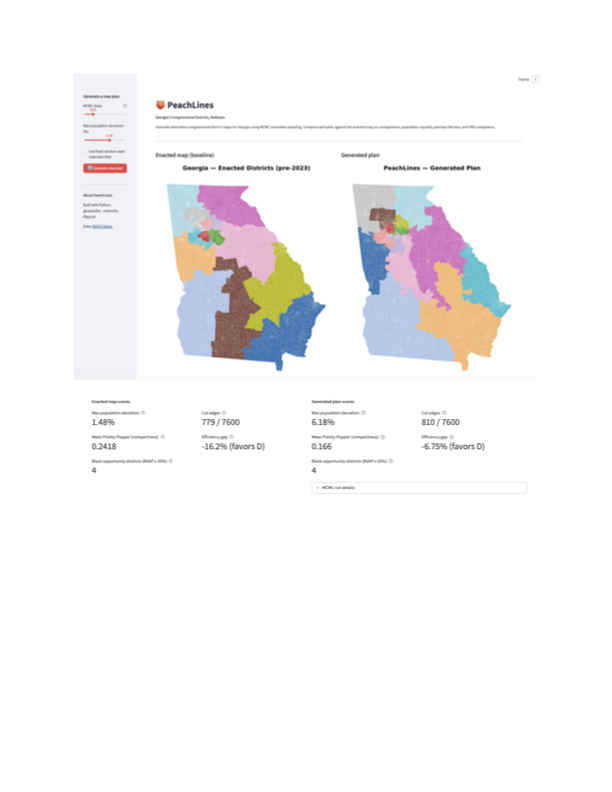

# 🍑 PeachLines — Georgia's Congressional Districts, Redrawn

An algorithmic redistricting tool that generates and evaluates alternative congressional district maps for Georgia using MCMC ensemble sampling — scoring each plan against compactness, population equality, partisan fairness, and Voting Rights Act compliance.

Built as an interactive Streamlit app. Designed to be extended to other states.

---

## What it does

- Loads Georgia's 2,664 precincts as a precinct-level dual graph (adjacency graph over shared borders)
- Generates alternative district plans using Markov Chain Monte Carlo (MCMC) sampling
- Scores every plan on four axes:
  - **Population equality** — max % deviation from ideal district size
  - **Compactness** — Polsby-Popper score (shape-based; 1.0 = perfect circle)
  - **Partisan fairness** — efficiency gap vs. 2016 election results
  - **VRA compliance** — number of Black opportunity districts (BVAP ≥ 35% of VAP)
- Visualizes generated maps and score comparisons in an interactive UI
- Compares generated plans against Georgia's enacted map as a baseline

---

## Quickstart

```bash
git clone https://github.com/YOUR_USERNAME/peachlines.git
cd peachlines

# Get the data
git clone https://github.com/mggg-states/GA-shapefiles.git data/GA-shapefiles

# Install dependencies
pip install -r requirements.txt

# Run the app
streamlit run ui/app.py
```

---

## Project structure

```
peachlines/
├── core/
│   ├── graph.py      # Build precinct adjacency graph (nodes = precincts, edges = shared borders)
│   ├── scoring.py    # Score any plan on all four fairness axes
│   └── mcmc.py       # MCMC plan generation (ReCom-style proposal)
├── ui/
│   └── app.py        # Streamlit interactive interface
├── data/
│   └── GA-shapefiles/  # MGGG precinct shapefile + demographics (git cloned separately)
├── outputs/            # Generated maps and score exports
└── requirements.txt
```

---

## Baseline scores — Georgia's enacted map (pre-2023)

| Metric | Score | Notes |
|---|---|---|
| Max population deviation | 1.48% | Congressional standard is near 0% |
| Mean Polsby-Popper | 0.24 | 1.0 = circle; lower = less compact |
| Cut edges | 779 / 7,600 | ~10% of precinct borders cross district lines |
| Efficiency gap | −16.2% | Favors Democrats; >8% is often cited as meaningful |
| Black opportunity districts | 4 | Districts with BVAP ≥ 35% of VAP |

---

## A note on methodology

"Fair" is not a single number. This tool scores plans across multiple independent metrics that can disagree — a map that's great on compactness may trade off partisan symmetry, and vice versa. The tool makes those tradeoffs visible rather than collapsing them into one score.

**On race and the VRA:** Georgia has significant Voting Rights Act history (*Alpha Phi Alpha Fraternity, Inc. v. Raffensperger*, 2023). A race-blind algorithm is not legally neutral in this context — diluting minority voting power violates Section 2 of the VRA regardless of geometric intent. This tool tracks BVAP (Black voting-age population) per district as a compliance check, not as an optimization target.

---

## How the algorithm works

MCMC (Markov Chain Monte Carlo) doesn't generate a district map from scratch — it takes small random steps from a valid starting plan:

1. Start from Georgia's enacted districts (a valid seed)
2. Pick two adjacent districts at random
3. Merge them temporarily, build a random spanning tree of the combined region
4. Cut one edge of the spanning tree to split it back into two new districts
5. Accept if both new districts are contiguous and population-balanced
6. Repeat thousands of times, saving snapshots along the way

This is a simplified version of the **ReCom** (Regional Recombination) proposal used by [GerryChain](https://github.com/mggg/GerryChain) (MGGG). Each saved plan is a sample from the space of valid alternative maps — a different way Georgia could have been drawn.

---

## Data

- **Source:** [MGGG States — GA Shapefiles](https://github.com/mggg-states/GA-shapefiles) (A-rated)
- **Unit:** Precinct level (2,664 precincts, 14 congressional districts)
- **Demographics:** 2010 U.S. Census (TOTPOP, VAP, BVAP, WVAP)
- **Elections:** 2016 presidential results (PRES16D, PRES16R)
- **Graph:** 2,664 nodes, 7,600 edges, fully connected

---

## Tech stack

- **Python** — geopandas, networkx, libpysal, shapely, matplotlib
- **UI** — Streamlit
- **Algorithm** — MCMC ensemble sampling (ReCom-style)

---

## Roadmap

- [x] Data loaded and validated (2,664 precincts, fully connected graph)
- [x] Adjacency graph built
- [x] Scoring framework (population, compactness, partisan fairness, VRA)
- [x] MCMC plan generation
- [x] Streamlit interactive UI
- [ ] Score distribution visualization (ensemble histogram)
- [ ] Export generated plans as shapefiles
- [ ] Multi-state support
- [ ] Cloud deployment

## Screenshot 

